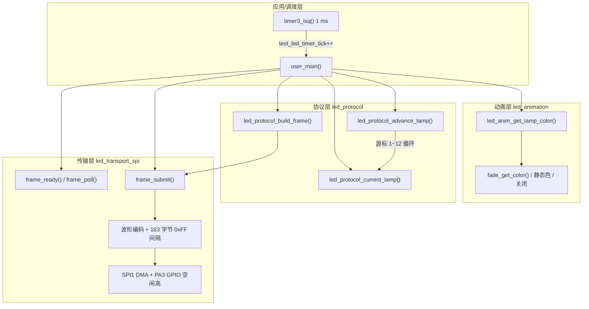
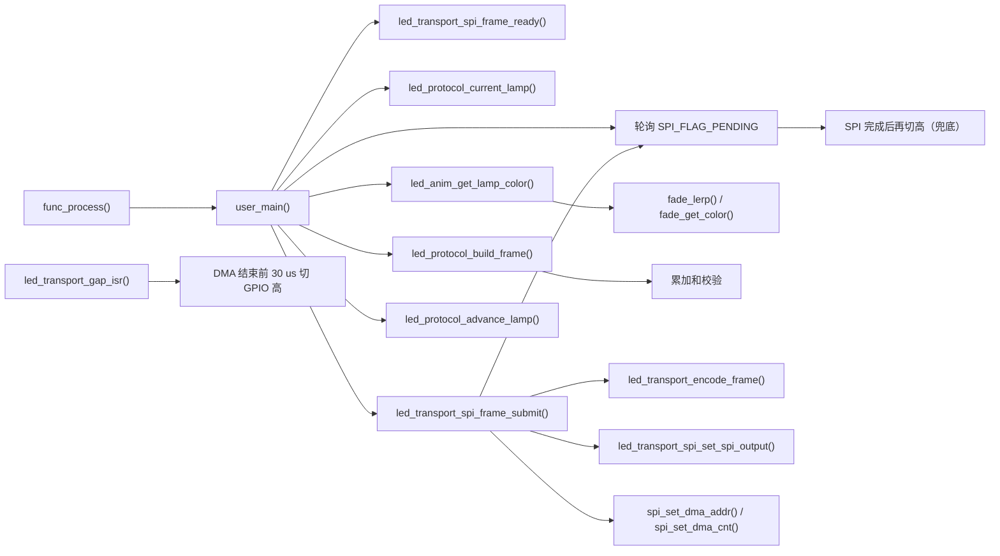
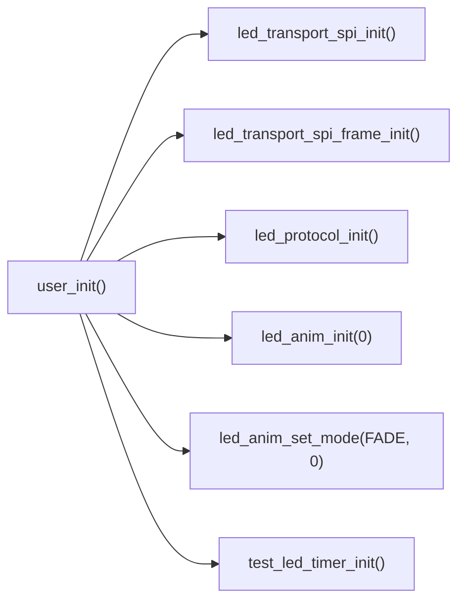
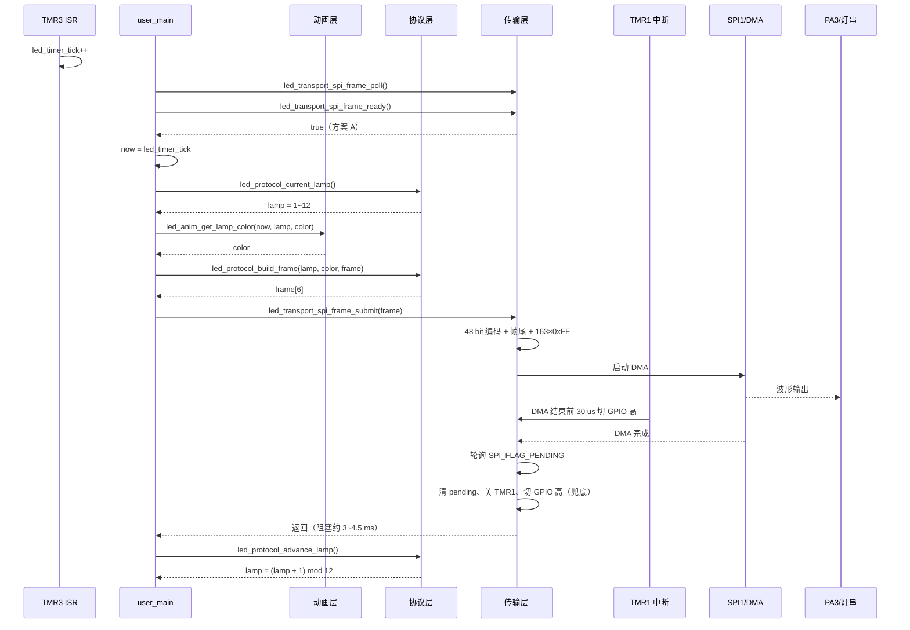
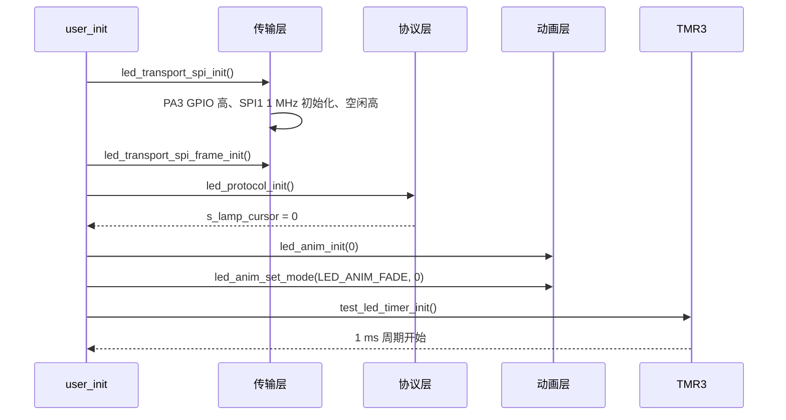
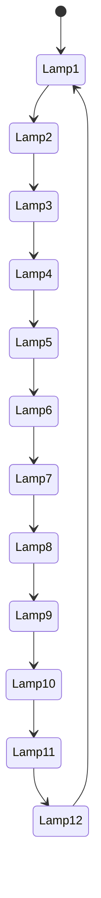

# LED 三层架构与调用逻辑

本文档描述当前 LED 灯串程序的三个层次：**动画层、协议层、传输层**，以及它们的调用层次、调用顺序、数据流和时序约束。

> **必须遵守的两条硬约束**
>
> 1. **TMR1 和 TMR3 中断优先级必须都为 0**，不能把 TMR1 设为 1。TMR1 设为 1 会压住 TMR3，导致 1 ms 时基不到来，fade 动画停住。
> 2. **灯串控制信号空闲时不能有负脉冲**。帧间隔 1312 us 高电平之后必须直接接下一帧的 8~9 us 低电平，中间不能出现 0.5 us 等任何低脉冲，否则灯串可能误判并闪烁。

---

## 1. 设计目标

- 动画层只负责“当前时间每盏灯应该是什么颜色”；
- 协议层只负责“把灯号和颜色组成协议帧”；
- 传输层只负责“把协议帧变成 SPI 波形并保证帧间隔”；
- 三层之间通过简单的数据结构和函数调用连接，不互相直接访问外设寄存器；
- 灯号 1~12 持续循环，颜色/动画/模式切换不能复位灯号；
- 模式切换在下一帧生效；
- 不使用动态内存、不使用递归，中断尽量短。

---

## 2. 三层职责

| 层次 | 文件 | 主要职责 | 不负责 |
|---|---|---|---|
| 动画层 | `led_animation.c/.h` | 按绝对时间计算每盏灯的 RGBW | SPI、协议帧、灯号循环 |
| 协议层 | `led_protocol.c/.h` | 灯号游标、组帧、校验 | 颜色渐变、SPI 波形 |
| 传输层 | `led_transport_spi.c/.h` | SPI 初始化、波形编码、DMA、帧间隔、空闲高电平 | 颜色含义、灯号选择 |
| 应用/调度 | `user_main.c` | 1 ms 时基、逐帧调用三层 | 具体波形和协议细节 |

---

## 3. 主要接口

公共类型：

```c
#define LED_LAMP_COUNT 12U
#define LED_FRAME_BYTES 6U

typedef struct {
    uint8_t r;
    uint8_t g;
    uint8_t b;
    uint8_t w;
} led_color_t;
```

### 3.1 动画层

```c
void led_anim_init(uint32_t now_ms);
void led_anim_set_mode(led_anim_mode_t mode, uint32_t now_ms);
void led_anim_set_static_color(const led_color_t *color);
void led_anim_get_lamp_color(uint32_t now_ms, uint8_t lamp,
                             led_color_t *out);
```

### 3.2 协议层

```c
void led_protocol_init(void);
uint8_t led_protocol_current_lamp(void);
void led_protocol_build_frame(uint8_t lamp, const led_color_t *color,
                              uint8_t frame[LED_FRAME_BYTES]);
void led_protocol_advance_lamp(void);
```

### 3.3 传输层

```c
void led_transport_spi_init(void);
void led_transport_spi_frame_init(void);
bool led_transport_spi_frame_ready(void);
void led_transport_spi_frame_submit(const uint8_t *frame);
void led_transport_spi_frame_poll(void);
```

---

## 4. 总体框图



---

## 5. 调用层次



初始化调用层次：



---

## 6. 单帧调用时序



---

## 7. 初始化时序



---

## 8. 协议帧格式

每帧 48 bit = 6 字节，MSB first：

| 字节 | 内容 | 说明 |
|---:|---|---|
| 0 | 灯号 | 1~12 |
| 1 | B | 蓝色分量 |
| 2 | G | 绿色分量 |
| 3 | R | 红色分量 |
| 4 | W | 白色分量 |
| 5 | 校验 | 前 5 字节累加和 `& 0xFF` |

协议层组帧：

```c
frame[0] = lamp;
frame[1] = color->b;
frame[2] = color->g;
frame[3] = color->r;
frame[4] = color->w;
frame[5] = (frame[0] + frame[1] + frame[2] +
            frame[3] + frame[4]) & 0xFF;
```

---

## 9. SPI 波形编码

SPI1 工作在 1 MHz，1 字节 = 8 us：

| 协议 bit | SPI 字节 | 时间 |
|---|---|---|
| 逻辑 0 | `0x00 + 3×0xFF` | 8 us 低 + 24 us 高 |
| 逻辑 1 | `0x00 + 7×0xFF` | 8 us 低 + 56 us 高 |

一帧：

```text
48 bit（MSB first）
+ 帧尾 0x00（8 us 低）
+ 帧尾 0xFF（8 us 高）
+ 163 字节 0xFF（1304 us 高）
```

帧尾到下一帧帧头约：

```text
8 us 低 + 8 us 高 + 163 × 8 us = 1320 us ≈ 1.32 ms
```

> 1320 us 来自之前四份采集（2 hour timer、美国国旗、Strobe、Fade）的平均帧间隔约 1321 us。

1 ms 时基由 TMR3 产生：

```text
160 MHz / 1600 = 100 kHz（10 us）
period = 100 - 1 → 100 × 10 us = 1 ms
```

---

## 10. 时序与刷新率

| 项目 | 数值 |
|---|---|
| SPI 时钟 | 1 MHz |
| 1 字节 | 8 us |
| 逻辑 0 单 bit | 32 us |
| 逻辑 1 单 bit | 64 us |
| 单帧 48 bit | 1.536~3.072 ms |
| 帧间隔 | 约 1.32 ms |
| 单帧总时间 | 约 2.8~4.4 ms（加切换/构建开销） |
| 12 帧一轮 | 约 35~53 ms |

说明：

- 传输层一次只发一帧；
- `user_main()` 每调用一次发一帧；
- 12 次调用完成灯号 1~12；
- 帧间隔由 DMA 中的 163 字节 `0xFF` 产生；
- TMR1 在 DMA 结束前约 30 us 把 PA3 提前切回 GPIO 高电平；主循环轮询 SPI pending 作为兜底；
- 下一帧构建和 GPIO 切换会额外增加几十 us，实际帧间隔略大于 1.32 ms。

---

## 11. 灯号规则

协议层维护一个持续游标：

```c
static uint8_t s_lamp_cursor;   /* 0~11 */
```

- 当前灯号：`s_lamp_cursor + 1`；
- 每发送完一帧：`s_lamp_cursor = (s_lamp_cursor + 1) % 12`；
- 灯号顺序：`1,2,3,...,12,1,2,...`；
- 动画切换、颜色变化、模式切换都**不能**修改 `s_lamp_cursor`；
- 因此即使在中途切换模式，灯号也不会重新从 1 开始。



---

## 12. 模式切换与下一帧生效

当前发送流程是：

1. `user_main()` 读取 `now`；
2. 取当前灯号；
3. 动画层计算当前颜色；
4. 协议层组帧；
5. 传输层发送这一帧（阻塞到帧尾 + 帧间隔）。

因此：

- 如果模式在 `frame_submit()` 期间切换，当前帧已经发出；
- 下一次 `user_main()` 会用新模式重新计算颜色；
- 即模式切换在**下一帧**生效；
- 灯号游标在 `frame_submit()` 之后前进，所以下一帧是下一个灯号。

```text
帧 N：旧模式颜色
  ↓ 发送 + 1.32 ms 间隔
模式切换发生
  ↓
帧 N+1：新模式颜色，灯号 N+1
```

注意：模式切换函数应在主循环上下文调用；如果从 ISR 调用，需要额外的 pending 标志，避免多字节变量竞争。

---

## 13. 方案 A 与方案 B

### 方案 A：当前实现

| 接口 | 行为 |
|---|---|
| `led_transport_spi_frame_ready()` | 恒返回 `true` |
| `led_transport_spi_frame_submit()` | 阻塞到本帧和帧间隔发送完成 |
| `led_transport_spi_frame_poll()` | 空实现 |

特点：

- 一次一帧；
- 代码简单；
- 模式切换下一帧生效；
- 主循环在发送期间被阻塞约 3~4.5 ms；
- DMA 完成中断里立即把 PA3 切回 GPIO 高，避免主循环被任务打断导致低电平拉长。

### 方案 B：预留

以后可改为双缓冲 + SPI 完成中断：

- `frame_ready()`：是否有空闲缓冲；
- `frame_submit()`：编码入队，立即返回；
- `frame_poll()`：处理 DMA 完成并启动下一帧。

主循环的调用方式保持不变。

---

## 14. 测试函数

```c
void test_led_transport_spi_send_static_12(void);
```

- 逐帧发送 12 盏灯的静态颜色；
- 每帧灯号 1~12；
- 每帧后带 163 字节 `0xFF` 间隔；
- 用于验证波形、灯号顺序和硬件映射；
- 不参与正常动画流程。

---

## 15. 硬件映射注意事项

之前实测：

- 只接前 6 个灯时，发送灯号 `1,2,3,4,5,6`，实际显示为 `1,2,3,3,2,1`；
- 原始图标数据中，`1~6` 与 `7~12` 通常相同；
- 说明灯串很可能是**两组 6 灯镜像**，每组 3 个唯一颜色。

当前动画层：

- 使用 12 个逻辑灯号；
- Fade/Static 模式下 12 盏灯颜色相同，不受映射影响；
- 后续实现图标/图案模式时，需要按实际硬件映射生成 12 个颜色，例如：
  - 美国国旗：`1~6 == 7~12 = 红、蓝、白、红、蓝、白`；
  - 三叶草：`1~6 == 7~12 = 绿、白、绿、白、绿、白`；
- 如果接满 12 个后确认第二组映射不同，只需要调整动画层的灯号到颜色表，不影响协议层灯号游标和传输层波形。

---

## 16. 代码约束

- 不使用 `malloc/free`；
- 不使用递归；
- 定时器 ISR 只做计数/引脚切换，必须保持短小；
- SPI 完成状态由主循环轮询，不依赖 SPI 完成中断；
- TMR1 与 TMR3 中断优先级都必须为 `0`；
- ISR 中不调用阻塞函数；
- 传输层的 `frame_submit()` 只在主循环/任务上下文调用；
- 所有缓冲区静态分配；
- 方案 A 下主循环发送一帧约 3~4.5 ms；
- 单帧缓冲区 549 字节，静态分配。

---

## 17. 文件清单

| 文件 | 说明 |
|---|---|
| `user_app/led_driver/led_animation.c/.h` | 动画层 |
| `user_app/led_driver/led_protocol.c/.h` | 协议层 |
| `user_app/led_driver/led_transport_spi.c/.h` | 传输层 |
| `user_app/user_main.c` | 1 ms 时基、初始化、逐帧调度 |

> 新增的 `led_animation.c`、`led_protocol.c` 需要手动加入 Code::Blocks 工程（`.cbp`），否则链接会找不到对应函数。

---

## 18. 空闲高电平保护（不能有负脉冲）

### 18.1 现象

SPI DMA 结束后，SPI1 会把 PA3 拉低。如果 GPIO 切换晚了，空闲高电平期间就会出现一个低脉冲：

```text
1312 us 高（帧间隔）
→ 0.5~0.75 us 低   ← 负脉冲
→ 26~29 us 高
→ 下一帧第一个 8~9 us 低
```

这个低脉冲不是协议里的数据 bit，而是一个**额外的非法脉冲**。即使只有 0.5 us，也可能被灯串芯片误判，导致灯光闪烁。

实测曾出现：

- 542 ns：没有被任务打断；
- 64 us、1.38 ms、5.8 ms：被其他任务/中断打断；
- 0.5~0.75 us：TMR1 没有在 DMA 结束前切高，轮询兜底在 DMA 结束瞬间才切高。

### 18.2 当前处理

用 **TMR1 在 DMA 结束前约 30 us 提前切高**：

```text
DMA 结束前 30 us：TMR1 中断
→ 此时 SPI 还在输出 0xFF 高电平
→ 切 GPIO 高，高到高
→ 不产生低脉冲
```

TMR1 按 **10 us 分辨率**工作，10 us 对应 1600 个计数：

```c
#define LED_TRANSPORT_TMR1_10US_TICKS 1600U
#define LED_TRANSPORT_GAP_SWITCH_MARGIN_US 30U
```

```c
us = wave_len * 8;
us -= 30;
units = us / 10;
ticks = units * 1600;
```

- 初始化时 `tmr_cmd(TMR1, DISABLE)`；
- 中断里先 `tmr_cmd(TMR1, DISABLE)`，再清标志、切 GPIO 高；
- 只在 `frame_submit()` 中启动一次，保证一次性；
- 主循环轮询 `SPI_FLAG_PENDING` 作为兜底；
- 兜底完成后再清 pending、关 TMR1、切 GPIO 高。

当前代码**不使用 SPI 完成中断**，避免中断未进入导致 `frame_done` 永远不置位。

### 18.3 实测结果

最新波形：

- 采集 2304 ms；
- 636 帧；
- 所有低电平：**8.0~9.29 us**；
- 所有高电平：**24~1355.67 us**；
- 帧间隔后的 **0.5 us 负脉冲已经消失**；
- 灯号 1~12 连续循环；
- fade 正常推进。

### 18.4 注意

- TMR1 和 TMR3 的中断优先级**必须都为 0**；
- 不能把 TMR1 设为 1，否则会压住 TMR3，fade 会停住；
- 如果 TMR1 晚到，空闲低脉冲会重新出现；
- 如果要求物理上绝对零低，最终方案是加硬件 OR 门：`PA3 = SPI_DATA OR GPIO_IDLE_EN`。

---

## 19. 踩坑记录（必须遵守）

### 19.1 TMR1/TMR3 中断优先级必须一样，都是 0

TMR1 负责在 DMA 结束前切高，TMR3 负责 1 ms 时基。两者优先级必须一致：

```c
tmr_pic_config(TMR1, led_transport_gap_isr, 0, TMR_IT_UPDATE, ENABLE);
tmr_pic_config(TMR3, timer3_isq, 0, TMR_IT_UPDATE, ENABLE);
```

**不能把 TMR1 设为 1。**

实测把 TMR1 设为 1 后：

- TMR1 会覆盖 TMR3；
- TMR3 的 1 ms 中断不能正常到来；
- `led_timer_tick` 不增加或增加极慢；
- fade 动画看起来“没有在跑”；
- 颜色长时间停在红色附近。

所以：

```text
TMR1 优先级 = 0
TMR3 优先级 = 0
```

必须保持一致。

### 19.2 灯串控制信号空闲时不能有负脉冲

空闲高电平期间**不能出现任何低脉冲**，包括 0.5 us 这种极短脉冲。

正常帧边界应该是：

```text
1312 us 高
→ 下一帧第一个 8~9 us 低
→ 24/56 us 高
```

不能是：

```text
1312 us 高
→ 0.5 us 低   ← 非法负脉冲
→ 26 us 高
→ 9 us 低
```

原因：

- 0.5 us 低不是合法数据 bit；
- 后面的 26 us 高也不是合法 bit；
- 灯串芯片可能把它当成额外 bit 或错误边界；
- 结果是灯光闪烁、颜色错位或整帧偏移。

判断标准：

- 帧内低电平：约 8~9 us；
- 帧内高电平：约 24 us（0）或 56 us（1）；
- 帧间隔：约 1312 us 高；
- 帧间隔后直接是下一帧的 8~9 us 低；
- 中间不能再出现任何低脉冲。

### 19.3 TMR1 的其他注意事项

- TMR1 的 `prescale` 无效，只有 TMR3 支持 `prescale`；
- 不能按 160 MHz 直接算 TMR1 周期；
- 当前按实测 **10 us = 1600 ticks** 计算；
- TMR1 必须一次性：初始化关闭，中断里关闭，只在 `frame_submit()` 启动；
- 如果 TMR1 周期算错，会提前切高，截断整帧，表现为“8.7 us 低 + 3.5 ms 高”。

### 19.4 SPI 完成中断不可靠

实测 SPI 完成中断没有进入，导致：

- `frame_done` 永远不置位；
- `frame_submit()` 卡死；
- 看门狗复位；
- 每约 1.9 s 只发一帧，灯号一直是 1。

所以当前改为：

```text
主循环轮询 SPI_FLAG_PENDING
```

不再依赖 SPI 完成中断。
